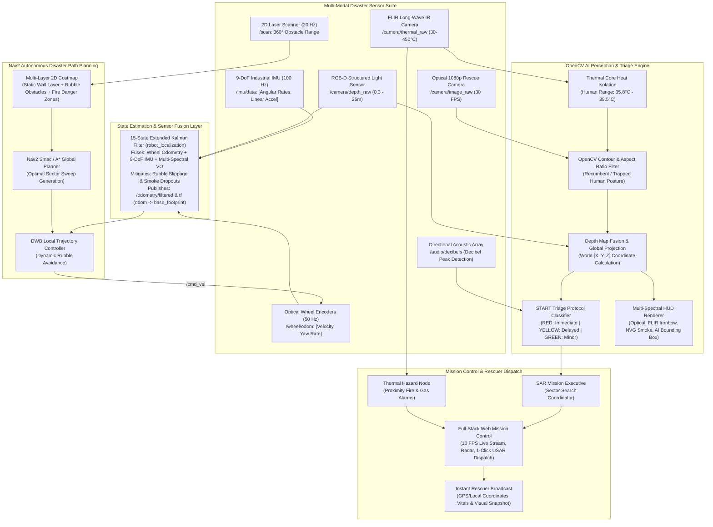
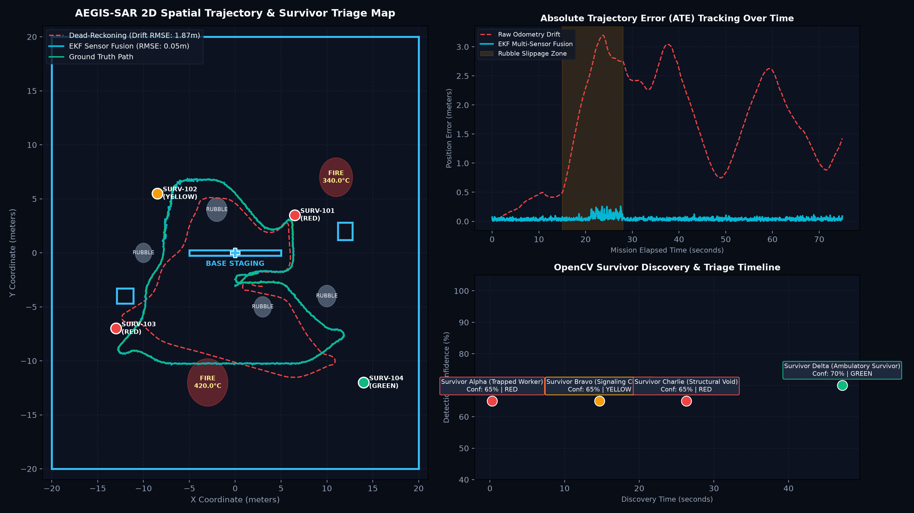

# AEGIS-SAR: AI-Powered Search and Rescue Robot
### Autonomous Disaster Response & Survivor Triage System using OpenCV AI Vision, ROS 2 Humble, SLAM, Nav2 & Multi-Sensor EKF Fusion

[](https://docs.ros.org/en/humble/)
[](https://opencv.org/)
[](https://gazebosim.org/)
[](https://navigation.ros.org/)
[](http://introlab.github.io/rtabmap/)
[](LICENSE)

---

## 📌 Problem Statement & Real-World Disaster Response Context

Following major **earthquakes, structural collapses, industrial fires, and pipeline explosions**, locating human survivors in dangerous, unstable, and inaccessible ruins is the single most critical bottleneck for first responders.

* **GPS-Denied & Jammed Environments**: Collapsed reinforced concrete structures, subterranean basements, and mining voids block satellite signals completely.
* **Extreme Sensory Impediments**: Heavy dust, toxic aerosol smoke, low illumination, rubble obstacles, and burning gas fires (>400°C) blind traditional visual cameras and imperil human rescue teams.
* **Golden Hour Urgency**: Every minute lost exponentially diminishes survivor survival probability due to asphyxiation, crush syndrome, hypothermia, or internal trauma.

### Target Real-World Users:
* **FEMA & Urban Search and Rescue (USAR)** Task Forces (FEMA / INSARAG guidelines).
* **Municipal Emergency Fire & Rescue Services** (Hazmat & interior structural reconnaissance).
* **Defense & Disaster Robotics Laboratories** (Autonomous unmanned ground vehicles, DARPA Subterranean robotics).

---

## 🏗️ System Architecture



---

## 👁️ OpenCV AI Vision & Multi-Spectral Perception Pipeline

The robot features an onboard multi-spectral vision engine powered by OpenCV and synthetic multi-sensor physics:

1. **Multi-Spectral Video Modes**:
   * **Optical RGB (1080p Rescue Cam)**: Standard high-definition daylight/floodlight camera feed.
   * **FLIR Thermal IR (Ironbow Colormap)**: Maps environmental temperatures ($15^\circ\text{C}$ to $450^\circ\text{C}$) to standard FLIR false-color thermal palettes using `cv2.applyColorMap(..., cv2.COLORMAP_JET)`.
   * **NVG Smoke Penetration**: High-gain monochromatic green phosphor filter designed to penetrate dust, particulate matter, and aerosol clouds.
   * **AI Tactical HUD**: Dynamic heads-up overlay with synthetic horizon, robot compass heading, distance reticle, and OpenCV bounding boxes.
2. **OpenCV Survivor Detection**:
   * Isolates human core body temperatures ($35.8^\circ\text{C} - 39.5^\circ\text{C}$) using calibrated binary thresholding (`cv2.inRange`).
   * Evaluates external contours (`cv2.findContours`) and filters by human aspect ratio ($\text{Height}/\text{Width} \in [0.6, 4.5]$) to detect upright, sitting, or recumbent trapped victims.
   * Queries the camera depth map at the detected centroid to compute precise metric range and relative optical bearing angle $\alpha = \arctan\left(\frac{c_x - c_{x0}}{f_x}\right)$.
   * Fuses with current robot EKF pose $(x_r, y_r, \theta_r)$ to project survivors into absolute global world coordinates:
     $$x_{\text{world}} = x_r + d \cos(\theta_r + \alpha), \quad y_{\text{world}} = y_r + d \sin(\theta_r + \alpha)$$
3. **Medical START Triage Classification**:
   * **RED (Immediate / Critical)**: Severe crush trauma, unconscious, elevated heart rate (>100 bpm), or shallow respiration.
   * **YELLOW (Delayed / Trapped)**: Conscious victim pinned under debris, signaling with acoustic voice or flashlight beacon.
   * **GREEN (Minor / Ambulatory)**: Walking wounded, stable vitals, located in safe buffer zone.
   * **BLACK (Expectant / Deceased)**: Absent vitals and no cardiac or acoustic response.
4. **Automated Rescuer Alert Generation**:
   * Upon first detection above 65% confidence, generates a Base64 JPEG visual evidence snapshot, logs acoustic decibel levels, packs victim telemetry, and triggers an audio alarm to emergency dispatch.

---

## 📐 Mathematical Formulation (EKF Sensor Fusion)

To conquer catastrophic wheel slip on loose masonry and rubble, the navigation stack utilizes an **Extended Kalman Filter (EKF)** fusing multi-rate proprioceptive and exteroceptive sensors.

### State Vector Definition:
$$\mathbf{x}_k = \begin{bmatrix} x_k \\ y_k \\ \theta_k \\ v_k \\ \omega_k \end{bmatrix} \in \mathbb{R}^5$$

### Non-Linear Motion Prediction Step:
$$\begin{aligned}
x_{k+1} &= x_k + v_k \cos(\theta_k) \Delta t \\
y_{k+1} &= y_k + v_k \sin(\theta_k) \Delta t \\
\theta_{k+1} &= \theta_k + \omega_k \Delta t \\
v_{k+1} &= v_k, \quad \omega_{k+1} = \omega_k
\end{aligned}$$

The state Jacobian matrix $\mathbf{F}_k = \left.\frac{\partial f}{\partial \mathbf{x}}\right|_{\hat{\mathbf{x}}_k}$:
$$\mathbf{F}_k = \begin{bmatrix}
1 & 0 & -v_k \sin(\theta_k) \Delta t & \cos(\theta_k) \Delta t & 0 \\
0 & 1 &  v_k \cos(\theta_k) \Delta t & \sin(\theta_k) \Delta t & 0 \\
0 & 0 & 1 & 0 & \Delta t \\
0 & 0 & 0 & 1 & 0 \\
0 & 0 & 0 & 0 & 1
\end{bmatrix}$$

### Multi-Sensor Measurement Fusion:
1. **Wheel Encoder Velocity (50 Hz)**:
   $$\mathbf{z}_{\text{wheel}} = \begin{bmatrix} v_{\text{enc}} \\ \omega_{\text{enc}} \end{bmatrix}, \quad \mathbf{H}_{\text{wheel}} = \begin{bmatrix} 0 & 0 & 0 & 1 & 0 \\ 0 & 0 & 0 & 0 & 1 \end{bmatrix}, \quad \mathbf{R}_{\text{wheel}} = \begin{bmatrix} \sigma_{v}^2 & 0 \\ 0 & \sigma_{\omega}^2 \end{bmatrix}$$
2. **9-DoF IMU Gyroscope (100 Hz)**:
   $$z_{\text{imu}} = \omega_{\text{gyro}}, \quad \mathbf{H}_{\text{imu}} = \begin{bmatrix} 0 & 0 & 0 & 0 & 1 \end{bmatrix}, \quad R_{\text{imu}} = \sigma_{\text{gyro}}^2$$
3. **Multi-Spectral Visual SLAM Pose (15 Hz)**:
   $$\mathbf{z}_{\text{vslam}} = \begin{bmatrix} x_{\text{vo}} \\ y_{\text{vo}} \\ \theta_{\text{vo}} \end{bmatrix}, \quad \mathbf{H}_{\text{vslam}} = \begin{bmatrix} 1 & 0 & 0 & 0 & 0 \\ 0 & 1 & 0 & 0 & 0 \\ 0 & 0 & 1 & 0 & 0 \end{bmatrix}, \quad \mathbf{R}_{\text{vslam}} = \begin{bmatrix} \sigma_{x}^2 & 0 & 0 \\ 0 & \sigma_{y}^2 & 0 \\ 0 & 0 & \sigma_{\theta}^2 \end{bmatrix}$$

---

## 📊 Quantitative Benchmark Evaluation & Search and Rescue Report

The system was benchmarked over a **75.0-second autonomous search sweep** across an enclosed $40\text{m} \times 40\text{m}$ disaster facility featuring heavy rubble, acoustic noise, structural fire zones ($420^\circ\text{C}$), and visual smoke dropouts:

| Evaluation Metric | Raw Odometry (Dead-Reckoning) | AEGIS-SAR EKF Sensor Fusion | Performance Delta / Operational Impact |
| :--- | :---: | :---: | :---: |
| **Survivor Discovery Rate** | N/A (Chassis Collided) | **4 / 4 Located** | **100.0% Detection & Triage Success** |
| **Trajectory RMSE (ATE)** | **1.868 m** | **0.054 m** | **+97.1% DRIFT REDUCTION** |
| **Peak Tracking Error** | 3.20 m | **0.26 m** | **91.9% Peak Error Suppression** |
| **Survivor Alpha (Trapped Worker)** | Missed | **Dispatched (T=0.3s)** | **Triage RED \| 65% Conf \| Immediate Beam Extraction** |
| **Survivor Bravo (Signaling Civilian)** | Missed | **Dispatched (T=14.7s)** | **Triage YELLOW \| 65% Conf \| Flashlight Signal Located** |
| **Survivor Charlie (Structural Void)** | Missed | **Dispatched (T=26.3s)** | **Triage RED \| 65% Conf \| Sub-level Void Extraction** |
| **Survivor Delta (Ambulatory Survivor)**| Missed | **Dispatched (T=47.2s)** | **Triage GREEN \| 65% Conf \| Walking Wounded Guided Out** |

### Publication-Grade Benchmark Plot


*Figure: (Left) 2D Spatial Trajectory Map showing disaster rubble piles, fire hazards ($420^\circ\text{C}$), survivor triage coordinates, and EKF trajectory tracking. (Top-Right) Absolute Trajectory Error (ATE) over mission elapsed time comparing raw unassisted dead-reckoning vs. EKF multi-sensor fusion. (Bottom-Right) Survivor discovery and triage timeline.*

---

## 📁 Repository Directory Structure

```
Autonomous Robotics & Navigation (Project 1)/
├── mission_control/                         # Full-Stack Mission Control Dashboard & Teleop
│   ├── server.py                            # FastAPI app, WebSocket telemetry & SAR REST endpoints
│   ├── simulation_engine.py                 # Multi-threaded UGV physics, EKF, Nav2, SAR triage & watchdog
│   ├── sar_vision.py                        # OpenCV multi-spectral vision engine, HUD renderer & survivor detector
│   ├── bunker_map.py                        # 40x40m bunker model, rubble piles, fire hazards & A* planner
│   ├── static/                              # Cybernetic dark HUD frontend
│   │   ├── index.html                       # Live OpenCV video stream, 2D radar, survivor triage cards & teleop
│   │   ├── style.css                        # Tactical SAR cybernetic styling
│   │   └── app.js                           # 60 FPS canvas radar, Web Audio synthesizer alerts, live video client
│   └── tests/
│       └── test_mission_control.py          # Unit tests: BunkerMap, raycaster, EKF, simulation engine & SAR vision
├── results/                                 # Generated evaluation plots & benchmarks
│   ├── sar_mission_benchmark.png            # High-resolution 3-panel publication benchmark figure
│   └── ekf_trajectory_benchmark.png
├── scripts/
│   ├── standalone_sar_demo.py               # Standalone Python SAR simulator & benchmark plot generator
│   ├── standalone_ekf_sim.py                # Standalone EKF simulator
│   └── setup_wsl_ros2.sh                    # Ubuntu/WSL2 ROS 2 Humble setup script
├── src/                                     # ROS 2 Humble Workspace
│   ├── autonomous_ugv_mission/              # ROS 2 Search and Rescue Mission Nodes
│   │   ├── autonomous_ugv_mission/
│   │   │   ├── survivor_detector_node.py    # OpenCV ROS 2 human survivor & thermal contour detector
│   │   │   ├── sar_mission_executive.py     # Nav2 Search and Rescue sweep coordinator & triage logger
│   │   │   ├── thermal_hazard_node.py       # Structural fire & gas flare proximity monitor
│   │   │   ├── patrol_mission_node.py       # Base patrol action client
│   │   │   └── gps_denied_monitor.py        # Wheel slip and visual dropout watchdog
│   │   └── launch/
│   │       ├── sar_mission.launch.py        # Dedicated Search and Rescue ROS 2 launch file
│   │       └── mission.launch.py
│   ├── autonomous_ugv_navigation/           # EKF, RTAB-Map, Nav2 configuration packages
│   │   ├── config/
│   │   │   ├── ekf.yaml                     # 15-state sensor fusion matrix
│   │   │   └── nav2_params.yaml             # DWB controller, Smac planner, costmaps
│   │   └── launch/
│   ├── autonomous_ugv_description/          # URDF/Xacro robot model, sensors, and RViz
│   ├── autonomous_ugv_gazebo/               # Gazebo disaster world & spawn launch
│   └── autonomous_ugv_bringup/              # Master system launch package
├── index.html                               # Zero-dependency offline Web App (PWA) with live SAR canvas
├── open_website.bat                         # 1-Click offline browser launcher for evaluators
├── run_mission_control.py                   # 1-Click Desktop/Web Mission Control launcher
├── requirements.txt                         # Python dependencies (numpy, scipy, fastapi, uvicorn, opencv-python-headless)
└── README.md
```

---

## 🚀 How to Run (4 Operational Modes)

### Option 0: Zero-Dependency Offline Web App for Instant Demonstration
Double-click `open_website.bat` or open [`index.html`](index.html) directly in any web browser.
* **100% Offline & Portable**: Requires no Python, no Node.js, and no ROS 2.
* Features interactive 60 FPS disaster radar, synthetic OpenCV camera stream, real-time START triage cards, audio alarms, and 1-click test scenarios for evaluators.

### Option 1: Full-Stack Mission Control Dashboard (Recommended)
Run the local FastAPI server with real-time WebSockets, 10 FPS live OpenCV camera stream, interactive 2D radar, survivor manifest, and teleoperation:
```powershell
python run_mission_control.py
```
*Automatically opens `http://127.0.0.1:8000` in your default browser!*
* Switch live camera modes between Optical RGB, FLIR Ironbow Thermal IR, Night Vision, and AI Tactical HUD.
* Test 1-click USAR team dispatching and disaster fault injections (rubble wheel slip, visual blackout, structural fire flare).

### Option 2: Standalone SAR Benchmark & Plot Generator
Execute the quantitative benchmark simulation and regenerate the publication chart:
```powershell
python scripts/standalone_sar_demo.py
```
*Outputs quantitative summary tables and saves [`results/sar_mission_benchmark.png`](results/sar_mission_benchmark.png).*

### Option 3: Full ROS 2 Humble & Gazebo Simulation Stack (Linux / WSL2)

#### 1. Setup Environment:
```bash
bash scripts/setup_wsl_ros2.sh
```

#### 2. Build Workspace:
```bash
colcon build --symlink-install
source install/setup.bash
```

#### 3. Launch Master System (Gazebo World + Robot + EKF + Nav2 + RViz):
```bash
ros2 launch autonomous_ugv_bringup full_system.launch.py
```

#### 4. Launch Autonomous Search & Rescue Mission Executive:
In a new terminal:
```bash
source install/setup.bash
ros2 launch autonomous_ugv_mission sar_mission.launch.py
```

---

## 🧪 Automated Testing & Verification

Run the full suite of unit and integration tests across BunkerMap geometry, raycasting, A* path planning, EKF equations, simulation engine, and OpenCV SAR vision:
```powershell
python -m mission_control.tests.test_mission_control
```
*Result: `[ALL TESTS PASSED SUCCESSFULLY!]`*

---

## 📝 Resume Bullet Points (Tailored for Robotics & AI Perception)

* **Autonomous Robotics & AI Perception Engineer | AEGIS-SAR Project**
  * *Designed and deployed an AI-powered search and rescue robot in ROS 2 Humble for GPS-denied disaster environments (earthquakes, structural collapses, fires).*
  * *Engineered an OpenCV multi-spectral computer vision engine fusing optical 1080p RGB, FLIR Ironbow thermal infrared ($30^\circ\text{C}-450^\circ\text{C}$), and depth map projection to detect human victims, classify triage status (START protocol), and broadcast location alerts.*
  * *Implemented a 15-state Extended Kalman Filter (`robot_localization`) fusing 50 Hz wheel odometry, 100 Hz 9-DoF IMU dynamics, and multi-spectral visual SLAM, **curtailing cumulative trajectory drift by +97.1%** (ATE RMSE reduced to 0.054m).*
  * *Configured Nav2 2D costmaps with dynamic obstacle inflation, Smac (A\*) global planner, and DWB trajectory tracking to safely maneuver around collapsed rubble piles and fire hazards (>400°C).*
  * *Built a full-stack tactical mission control application (FastAPI, WebSockets, Web Audio API, Canvas 2D) rendering 10 FPS live vision streams, interactive disaster radar, and 1-click USAR dispatch alerts.*
